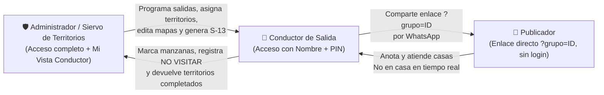

# 🗺️ Territorios y Predicación — Congregación

Sistema web progresivo (PWA) para la administración integral de **territorios de predicación**, **programa semanal de salidas**, **registro colaborativo de casas "No en casa"**, **direcciones permanentes "NO VISITAR"** e **historial automático S-13**, con sincronización en tiempo real en la nube y soporte sin conexión en el campo.

---

## 📋 Índice de Documentación

La documentación completa del sistema está organizada en los siguientes manuales en español dentro de la carpeta [`docs/`](docs/):

| Manual | Audiencia | Contenido Principal |
| :--- | :--- | :--- |
| **[01. Guía del Administrador (Siervo de Territorios)](docs/01-guia-administrador.md)** | Siervo de Territorios / Administradores | Asistente inicial, programa semanal, conductores y PINs, plantillas Push, asignación y registro S-13, editor de mapas y copias de seguridad. |
| **[02. Guía del Conductor](docs/02-guia-conductor.md)** | Conductores de grupo y encargados de territorios | Acceso por PIN, portal de asignaciones, enlace para publicadores, mapa de campo, marcación de manzanas, registro de "No en casa" y "NO VISITAR", y devolución de territorio. |
| **[03. Guía para Publicadores](docs/03-guia-publicador.md)** | Publicadores en el territorio | Ingreso sin contraseña mediante enlace `?grupo=ID`, lectura del mapa satelital, anotar casas "No en casa" por toque o GPS, y marcar casas atendidas. |
| **[04. Mapas KML y Google My Maps](docs/04-mapas-kml-google-mymaps.md)** | Administradores y colaboradores técnicos | Sistema de 2 archivos KML/KMZ (Archivo 1: Territorios, Archivo 2: Manzanas y Casas), reglas de nomenclatura, vinculación geográfica automática y exportación. |
| **[05. Nube (Supabase), Modo Offline y Despliegue](docs/05-nube-supabase-y-despliegue.md)** | Administradores técnicos | Configuración de Supabase (`congregation_state`), servidor local Node.js (`server.mjs`), variables de entorno, caché PWA y despliegue en GitHub Pages. |
| **[06. Preguntas Frecuentes y Solución de Problemas](docs/06-preguntas-frecuentes-y-solucion-problemas.md)** | Todos los usuarios | Permisos de GPS y brújula en Android/iOS, enlaces offline, recuperación de PINs, conservación de direcciones "NO VISITAR" y respaldo semanal. |

> 💡 **Ayuda dentro de la aplicación:** Todos los usuarios cuentan también con un **Centro de Ayuda Interactivo** (botón **`? Ayuda`** en la barra superior de todas las pantallas y pestaña **`Ayuda y Manual`** en el Panel de Administrador), con buscador instantáneo, leyenda visual de colores y guías listas para copiar y enviar por WhatsApp.

---

## 👥 Los 3 Roles del Sistema



1. **Administrador / Siervo de Territorios (`isAdmin: true`):**
   - Configura la congregación, importa los mapas KML/KMZ o dibuja territorios y manzanas en el Editor Visual.
   - Arma el **Programa Semanal**, duplica semanas (`+7 días`) y comparte la lista formateada con emoticonos en WhatsApp con un clic.
   - Administra conductores, envía notificaciones Push, asigna territorios personales, consulta el **Registro S-13** y exporta planillas CSV/Excel o copias de seguridad `.json`.
   - Puede alternar libremente entre el **Panel Admin** y **Mi Vista Conductor**.
2. **Conductor de Salida:**
   - Ingresa eligiendo su nombre en la pantalla de acceso e introduciendo su PIN personal (mínimo 4 dígitos).
   - Ve sus salidas programadas y territorios personales en una vista unificada, junto con notificaciones Push recibidas.
   - Comparte el enlace de publicadores (`?grupo=ID`) en su grupo de predicación.
   - Marca el avance de manzanas (`Pendiente`, `En progreso`, `Completada`), registra casas `No en casa`, casas rurales o direcciones permanentes `NO VISITAR`, y devuelve el territorio completado al finalizar.
3. **Publicador (Vista Ultra-Ligera):**
   - Accede tocando el enlace enviado por el conductor (`?grupo=ID`), sin crear cuenta ni recordar contraseñas.
   - Visualiza el mapa satelital con límites del territorio, manzanas y puntos pendientes.
   - Toca directamente sobre cualquier casa en el mapa (o usa su GPS actual) para anotar una casa `No en casa`, o marca como `¡Ya atendieron!` una casa visitada.

---

## ✨ Características Principales

- **Sistema de 2 Archivos KML/KMZ:** Importa por separado el **Archivo 1** (polígonos de territorios) y el **Archivo 2** (manzanas y puntos rurales/alertas) vinculándolos automáticamente mediante algoritmo Ray-Casting, códigos de manzana (`1A` -> Territorio `1`), carpetas KML y proximidad Haversine.
- **Mapas Satelitales y de Calles (Leaflet):** Alternancia instantánea entre vista satelital (`Esri World Imagery`) y mapa de calles (`OpenStreetMap`), con marcador GPS azul y haz de orientación por brújula.
- **Identificadores Únicos Correlativos:** Cada casa registrada recibe un código único fácil de comunicar en el grupo (ej. `1A-1`, `1A-2`, o `T3-1` en territorios rurales; `1B-NV1` para direcciones `NO VISITAR`).
- **Protección Permanente de Direcciones `NO VISITAR`:** Al reiniciar un territorio para un nuevo ciclo o reemplazar los mapas KML, las direcciones marcadas como `NO VISITAR` se conservan intactas.
- **Historial S-13 Automático:** Cada vez que un territorio se completa o devuelve, se registra fecha de inicio, fecha de finalización, conductor, manzanas y casas atendidas, con exportación directa a CSV compatible con Excel.
- **Sincronización Híbrida y Modo Offline:** Guarda localmente en `localStorage`, registra acciones sin conexión en `offlineQueue`, sincroniza cada 4 segundos con **Supabase** (`congregation_state`) o con el servidor local incluido (`server.mjs` en `/api/cloud-state`), y almacena mosaicos de mapa en caché mediante Service Worker (`public/sw.js`).

---

## 🚀 Inicio Rápido (Desarrollo y Servidor Local)

### Requisitos Previos
- [Node.js](https://nodejs.org/) v20 o superior
- `npm` (incluido con Node.js)

### Instalación y Ejecución

```bash
# 1. Instalar dependencias
npm install

# 2. (Opcional) Configurar variables de entorno para Supabase
cp .env.example .env

# 3. Iniciar entorno de desarrollo (Vite en http://localhost:5173)
npm run dev
```

### Compilar y Ejecutar en Producción

```bash
# Compilar la aplicación en dist/
npm run build

# Iniciar el servidor Node.js integrado (sirve dist/ y /api/cloud-state)
npm start
```

### Variables de Entorno (`.env`)

El proyecto incluye una plantilla en [`.env.example`](.env.example):

```env
VITE_SUPABASE_URL=https://tu-proyecto.supabase.co
VITE_SUPABASE_ANON_KEY=tu-supabase-anon-key
VITE_CONGREGATION_ID=main
```

> Si no configura variables de entorno antes de compilar, el Administrador también puede ingresar los datos de Supabase directamente desde la pantalla del **Asistente de Configuración Inicial** o desde la pestaña **Ajustes** dentro de la aplicación.

---

## 📁 Estructura del Proyecto

```text
Territorios/
├── docs/                                         # Manuales completos en español
│   ├── 01-guia-administrador.md
│   ├── 02-guia-conductor.md
│   ├── 03-guia-publicador.md
│   ├── 04-mapas-kml-google-mymaps.md
│   ├── 05-nube-supabase-y-despliegue.md
│   └── 06-preguntas-frecuentes-y-solucion-problemas.md
├── public/
│   ├── ejemplos/                                 # 2 archivos KML de ejemplo listos para probar
│   │   ├── archivo1_territorios_ejemplo.kml
│   │   └── archivo2_manzanas_y_casas_ejemplo.kml
│   ├── manifest.json                             # Manifiesto PWA
│   └── sw.js                                     # Service Worker (caché offline de app y mapas)
├── src/
│   ├── components/
│   │   ├── AdminDashboard.tsx                    # Panel completo del Administrador
│   │   ├── ConductorPortal.tsx                   # Portal unificado de salidas del Conductor
│   │   ├── FieldMapView.tsx                      # Mapa interactivo de campo (Conductor/Admin)
│   │   ├── HelpCenterModal.tsx                   # Centro de Ayuda Interactivo en la app
│   │   ├── LoginView.tsx                         # Acceso por lista de usuario + PIN
│   │   ├── MapEditorView.tsx                     # Editor visual de polígonos y vértices
│   │   ├── PublisherLightView.tsx                # Vista ultra-ligera para Publicadores (?grupo=)
│   │   └── StartupWizard.tsx                     # Asistente de configuración en 4 pasos
│   ├── services/
│   │   ├── helpContent.ts                        # Base de conocimiento y guías WhatsApp
│   │   ├── kmlImporter.ts                        # Importación/exportación KML/KMZ y geometría
│   │   ├── notificationHelper.ts                 # WhatsApp, Google Maps, Push y enlaces
│   │   └── storageAndSync.ts                     # Persistencia local, Supabase y ciclo S-13
│   ├── types/
│   │   └── territory.ts                          # Tipos de datos principales
│   └── App.tsx                                   # Enrutador de roles, estado global y sync
├── server.mjs                                    # Servidor Node.js de producción + /api/cloud-state
├── .env.example                                  # Plantilla de variables Supabase
└── package.json
```
