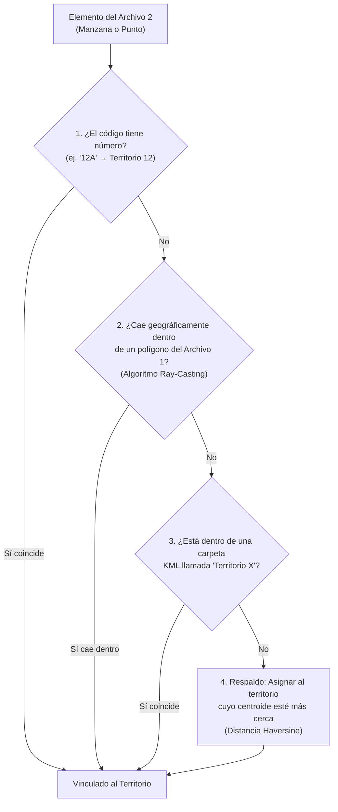

# 04. Mapas KML/KMZ y Google My Maps

La aplicación utiliza un **Sistema Inteligente de 2 Archivos** diseñado para importar directamente los mapas armados en **Google My Maps** (`.kml` o `.kmz`) y también para exportar los datos actualizados de vuelta hacia Google My Maps o Google Earth.

---

## 📑 Contenido
1. [Por Qué Se Usan 2 Archivos Separados](#1-por-qué-se-usan-2-archivos-separados)
2. [Cómo Exportar desde Google My Maps](#2-cómo-exportar-desde-google-my-maps)
3. [Estructura del Archivo 1: Territorios Individuales](#3-estructura-del-archivo-1-territorios-individuales)
4. [Estructura del Archivo 2: Manzanas, Casas Rurales y NO VISITAR](#4-estructura-del-archivo-2-manzanas-casas-rurales-y-no-visitar)
5. [Las 4 Reglas de Vinculación Automática](#5-las-4-reglas-de-vinculación-automática)
6. [Modo Reemplazar vs. Modo Agregar](#6-modo-reemplazar-vs-modo-agregar)
7. [Exportar Mapas hacia Google My Maps (.KML)](#7-exportar-mapas-hacia-google-my-maps-kml)
8. [Archivos de Ejemplo Incluidos](#8-archivos-de-ejemplo-incluidos)

---

## 1. Por Qué Se Usan 2 Archivos Separados

En la mayoría de las congregaciones que trabajan con Google My Maps, los límites generales de los territorios (Territorio 1, Territorio 2, etc.) están en una capa o mapa, y las manzanas detalladas (`1A`, `1B`, `2A`...) o casas rurales están en otra capa o mapa.

Separar la importación en **Archivo 1** y **Archivo 2** permite:
- Mantener los límites exteriores de cada territorio bien diferenciados de sus manzanas internas.
- Actualizar solo las manzanas o casas rurales sin tener que rearmar los contornos principales (o viceversa).
- Vincular automáticamente cada manzana y casa rural al territorio que le corresponde mediante algoritmos geográficos.

---

## 2. Cómo Exportar desde Google My Maps

1. Abra su mapa en [Google My Maps](https://www.google.com/maps/d/).
2. Haga clic en el menú de tres puntos (**⋮**) junto al título del mapa (o junto a la capa específica).
3. Seleccione **Exportar a KML/KMZ**.
4. Puede exportar:
   - Como archivo **`.kml`** (texto XML plano), o
   - Como archivo **`.kmz`** (archivo ZIP comprimido que contiene `doc.kml` adentro; la aplicación lo descomprime automáticamente en el navegador usando `JSZip`).
5. **Consejo:** Si tiene todo en un mismo mapa de My Maps en dos capas distintas (*Capa 1: Territorios*, *Capa 2: Manzanas y Casas*), en el diálogo de exportación elija exportar una sola capa por vez para obtener el **Archivo 1** y el **Archivo 2** por separado.

---

## 3. Estructura del Archivo 1: Territorios Individuales

El analizador (`parseTerritoriesKml`) lee todos los elementos `<Placemark>` que contengan un `<Polygon>`:

### Nomenclatura Reconocida
La función `extractTerritoryNumber` detecta automáticamente el número de territorio en nombres como:
- `Territorio 1`, `Territorio 14`
- `Terr. 4`, `T-4`, `T3`
- `1`, `1 - Centro`
- `Territorio 3 (Rural)`

### Detección Automática de Territorio Rural
Si el `<name>` o la `<description>` del polígono contienen alguna de las palabras **`rural`**, **`campo`** o **`quinta`** (sin importar mayúsculas/minúsculas), el territorio se clasifica inicialmente como tipo **`rural`**. De lo contrario se clasifica como **`urbano`**.

---

## 4. Estructura del Archivo 2: Manzanas, Casas Rurales y NO VISITAR

El analizador (`parseBlocksAndHousesKml`) distingue automáticamente entre **polígonos** (manzanas) y **marcadores puntuales** (casas o alertas):

### A. Polígonos (`<Polygon>`) → Manzanas
Cada polígono del Archivo 2 se importa como una **Manzana (`Block`)** en estado `pendiente`:
- Formatos de nombre recomendados: `1A`, `1B`, `Manzana 1C`, `Mz 2A`, `12-B`.
- La función `parseBlockCodeAndTerritoryNumber` limpia prefijos como `Manzana ` o `Mz. ` y extrae el código corto (ej. `1A`) junto con el número de territorio implícito (ej. `1` para `1A`, `12` para `12B`).

### B. Puntos (`<Point>`) → Casas Rurales y Alertas NO VISITAR
Cada marcador de punto del Archivo 2 se analiza según su `<name>` y `<description>`:
- **Si contiene `"no visitar"` o `"no tocar"`:** Se importa automáticamente como dirección permanente **`NO VISITAR`** (`category: 'no_visitar'`, `status: 'permanente'`).
- **Cualquier otro marcador puntual:** Se importa como **`Casa Rural`** (`category: 'casa_rural'`, `status: 'pendiente'`), por ejemplo `Casa Rural 1 - Tranquera Roja`.

### C. Clasificación Final del Territorio
Después de vincular todos los elementos del Archivo 2 con los del Archivo 1, el sistema recalcula el tipo de cada territorio:
- Solo manzanas → **`urbano`**
- Solo casas puntuales (sin manzanas) → **`rural`**
- Manzanas y casas puntuales combinadas → **`mixto`**

---

## 5. Las 4 Reglas de Vinculación Automática

Para decidir a qué Territorio pertenece cada Manzana o Punto del Archivo 2, la función `matchTerritoryForFeature` evalúa estas 4 reglas en orden estricto de prioridad:

Además, si un marcador puntual (`Casa Rural` o `NO VISITAR`) cae geográficamente dentro del polígono de alguna **Manzana**, queda vinculado automáticamente también con esa manzana (`blockId` y `blockCode`).

---

## 6. Modo Reemplazar vs. Modo Agregar

Antes de pulsar **`✅ Confirmar y Guardar Estos Mapas en la Nube`** (en *Ajustes -> Importar Mapas*), encontrará la casilla:
**`☑ Reemplazar mapas anteriores al guardar`**

- **Casilla MARCADA (Reemplazar):** Sustituye los territorios, manzanas y puntos anteriores por los recién importados, **pero protege y conserva automáticamente todas las direcciones permanentes `NO VISITAR`** que ya existieran en la base de datos.
- **Casilla DESMARCADA (Agregar):** Conserva todos los territorios, manzanas y casas actuales y añade al final los elementos de los nuevos archivos subidos. Ideal si desea sumar un territorio nuevo recién creado sin tocar el resto.

> 💡 Si necesita corregir únicamente bordes o nombres después de importar, puede usar directamente la pestaña **Editor de Mapas** sin necesidad de volver a subir archivos KML.

---

## 7. Exportar Mapas hacia Google My Maps (`.KML`)

En **Panel Admin → Ajustes → Importar o Exportar Mapas (Google My Maps)**, pulse:
**`🌍 Exportar Todo para Google Maps (.KML)`**

Esto genera un archivo KML 2.2 estándar (`Mapas_[Congregacion]_Google_Maps.kml`) con:
- **Carpeta `Territorios`:** Contornos de cada territorio con descripción de tipo, estado, hermano asignado y fechas.
- **Carpeta `Manzanas`:** Polígonos coloreados según si están pendientes (azul) o completadas (verde), con fecha y conductor.
- **Carpeta `Casas y Puntos`:** Pines diferenciados por color según categoría (`NO VISITAR` en rojo, `No en casa` en naranja, `Casa Rural` en azul y `Atendido` en verde).

Este archivo puede abrirse directamente en **Google My Maps** o **Google Earth Desktop/Web**.

---

## 8. Archivos de Ejemplo Incluidos

El proyecto incluye dos archivos de muestra listos para probar el funcionamiento completo en `public/ejemplos/`:
- [`public/ejemplos/archivo1_territorios_ejemplo.kml`](../public/ejemplos/archivo1_territorios_ejemplo.kml): Define 3 territorios (2 urbanos y 1 rural).
- [`public/ejemplos/archivo2_manzanas_y_casas_ejemplo.kml`](../public/ejemplos/archivo2_manzanas_y_casas_ejemplo.kml): Define las manzanas `1A`–`1D`, `2A`–`2C` y 5 casas rurales en carpetas KML separadas.

Puede cargarlos con un solo clic pulsando **`✨ Probar con los 2 KML de ejemplo`** tanto en el Asistente Inicial como en la pestaña *Ajustes*.
