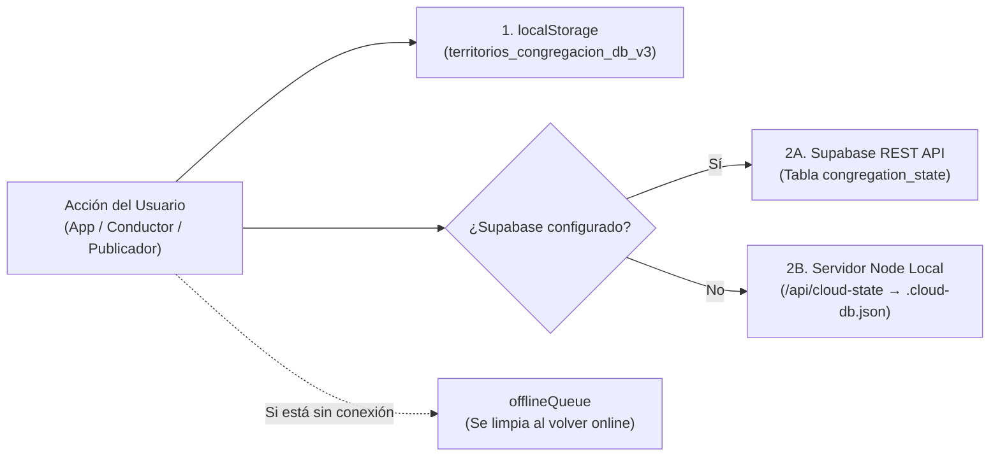

# 05. Nube (Supabase), Modo Offline y Despliegue

Este manual técnico explica cómo funciona la sincronización en tiempo real entre dispositivos, cómo configurar **Supabase**, cómo operar el servidor Node.js incluido y cómo desplegar la aplicación en **GitHub Pages**.

---

## 📑 Contenido
1. [Arquitectura de Almacenamiento Híbrido](#1-arquitectura-de-almacenamiento-híbrido)
2. [Configuración Paso a Paso de Supabase](#2-configuración-paso-a-paso-de-supabase)
3. [Variables de Entorno (.env) vs. Configuración en Pantalla](#3-variables-de-entorno-env-vs-configuración-en-pantalla)
4. [Múltiples Congregaciones en un Mismo Proyecto](#4-múltiples-congregaciones-en-un-mismo-proyecto)
5. [Modo Offline y Caché PWA de Mapas](#5-modo-offline-y-caché-pwa-de-mapas)
6. [Servidor Local Node.js (server.mjs)](#6-servidor-local-nodejs-servermjs)
7. [Despliegue Automático en GitHub Pages](#7-despliegue-automático-en-github-pages)

---

## 1. Arquitectura de Almacenamiento Híbrido

La aplicación nunca pierde datos si falla Internet porque combina tres capas de persistencia:



- **Lectura periódica (`fetchCloudDatabase`):** Cada **4 segundos**, todos los dispositivos conectados consultan el estado en la nube. Si el campo `lastUpdated` remoto es distinto al local, la interfaz se actualiza automáticamente sin recargar la página.
- **Guardado instantáneo (`saveDatabase`):** Cada modificación actualiza `lastUpdated`, guarda inmediatamente en `localStorage` y envía los cambios a Supabase (o a `/api/cloud-state` como respaldo local si Supabase no está habilitado).

---

## 2. Configuración Paso a Paso de Supabase

[Supabase](https://supabase.com/) ofrece un plan gratuito suficiente para almacenar el estado completo de la congregación en tiempo real:

### Paso A: Crear el Proyecto
1. Cree una cuenta gratuita en [supabase.com](https://supabase.com/) y haga clic en **New Project**.
2. Elija una organización, nombre del proyecto (ej. `territorios-congregacion`), contraseña de base de datos y región más cercana.
3. Espere unos 1–2 minutos a que el proyecto termine de provisionarse.

### Paso B: Crear la Tabla y Políticas RLS (Script SQL)
1. En el menú lateral izquierdo de Supabase, entre a **SQL Editor** y haga clic en **New query**.
2. Pegue exactamente el siguiente script SQL (también disponible con un botón de copia dentro del Asistente Inicial de la app) y pulse **Run**:

```sql
create table if not exists public.congregation_state (
  id text primary key,
  payload jsonb not null,
  updated_at timestamptz default now()
);

alter table public.congregation_state enable row level security;

drop policy if exists "Allow anon read congregation_state" on public.congregation_state;
create policy "Allow anon read congregation_state"
  on public.congregation_state
  for select
  to anon, authenticated
  using (true);

drop policy if exists "Allow anon insert congregation_state" on public.congregation_state;
create policy "Allow anon insert congregation_state"
  on public.congregation_state
  for insert
  to anon, authenticated
  with check (true);

drop policy if exists "Allow anon update congregation_state" on public.congregation_state;
create policy "Allow anon update congregation_state"
  on public.congregation_state
  for update
  to anon, authenticated
  using (true)
  with check (true);
```

### Paso C: Obtener URL y Anon Key
1. En Supabase vaya a **Project Settings (⚙️) → API** (o **Data API / API Keys**).
2. Copie los dos valores públicos:
   - **Project URL:** Ej. `https://abcdefghijklmno.supabase.co`
   - **`anon` `public` key:** Cadena larga que empieza por `eyJ...` (o clave pública `sb_publishable_...`). **Nunca** use la clave `service_role` en el frontend.

---

## 3. Variables de Entorno (`.env`) vs. Configuración en Pantalla

Puede conectar Supabase de cualquiera de estas dos maneras:

### Opción 1: Variables de Entorno en tiempo de compilación (Recomendada para GitHub Pages)
Cree un archivo `.env` en la raíz basado en `.env.example` (o configure los Secrets/Variables en GitHub Actions):

```env
VITE_SUPABASE_URL=https://tu-proyecto.supabase.co
VITE_SUPABASE_ANON_KEY=tu-clave-anon-public
VITE_CONGREGATION_ID=main
```

Cuando se compila con estas variables:
- Cualquier dispositivo nuevo que abra la URL (incluidos los **Publicadores** que solo abren un link `?grupo=ID`) se conecta automáticamente a la nube sin tener que configurar nada.
- En **Panel Admin → Ajustes** aparecerá la etiqueta verde **`✓ Configurado por Variables de Entorno`**.

### Opción 2: Configuración Manual desde la Interfaz
Si prefiere configurar Supabase desde el navegador:
- En el **Asistente de Configuración Inicial (Paso 1)** o en **Panel Admin → Ajustes → Sincronización en la Nube**, pegue la `Supabase Project URL`, la `Anon Key` y el `ID de Congregación`.
- La configuración se guarda en `localStorage` bajo la clave `territorios_supabase_config_v1`.

> ⚠️ **Importante:** Si usa únicamente configuración manual en pantalla (sin `.env`), cada dispositivo nuevo o publicador que abra un enlace en limpio no tendrá las credenciales guardadas en su navegador. Por eso, para uso en vivo con publicadores y múltiples celulares, **compile siempre con las variables `VITE_SUPABASE_URL` y `VITE_SUPABASE_ANON_KEY`**.

---

## 4. Múltiples Congregaciones en un Mismo Proyecto

La tabla `congregation_state` identifica cada congregación por su columna `id` (por defecto `main`).
Si desea reutilizar el mismo proyecto de Supabase para varias congregaciones vecinas:
- Cambie `VITE_CONGREGATION_ID` (por ejemplo `congregacion-norte`, `congregacion-sur`) en cada despliegue o en el campo **ID de Congregación** en Ajustes.
- Cada congregación leerá y escribirá únicamente su propia fila en `congregation_state` sin mezclarse con las demás.

---

## 5. Modo Offline y Caché PWA de Mapas

La aplicación incluye un Service Worker (`public/sw.js`) y un manifiesto (`public/manifest.json`) para trabajar en zonas con poca o nula señal móvil:

1. **Caché de la App:** Al visitar la web con conexión, `sw.js` almacena el HTML principal (`./`, `./index.html`, `./manifest.json`) y usa una estrategia *Network-first* con respaldo en caché para los archivos estáticos.
2. **Caché de Mapas Satelitales y de Calles:** Cada cuadrícula del mapa (`arcgisonline.com` para satélite y `tile.openstreetmap.org` para calles) vista antes de salir al campo se guarda automáticamente en el caché `territorios-map-tiles-v1`.
   - **Consejo práctico:** Antes de ir a un territorio rural sin señal, abra el territorio en su celular con Wi-Fi y haga zoom recorriendo la zona para que las imágenes satelitales queden cacheadas localmente.
3. **Cola Offline (`offlineQueue`):** Si registra una casa "No en casa" o marca una manzana sin conexión (`navigator.onLine === false`), el cambio se guarda en `localStorage` y la acción se registra en `offlineQueue`. Al recuperarse el evento `online`, la app sincroniza el estado actualizado con la nube y limpia la cola.

---

## 6. Servidor Local Node.js (`server.mjs`)

Si desea alojar la aplicación en un servidor propio (VPS, Raspberry Pi o PC en red local sin Supabase):

```bash
# 1. Compilar archivos estáticos en dist/
npm run build

# 2. Iniciar servidor en el puerto 5173 (o el indicado en PORT)
npm start
```

El archivo `server.mjs`:
- Sirve todos los archivos estáticos de `dist/` escuchando en `0.0.0.0:5173` (accesible desde celulares en la misma red Wi-Fi).
- Expone el endpoint `/api/cloud-state` (`GET` y `POST`) que guarda el JSON completo en el archivo `.cloud-db.json` en la raíz del proyecto.
- Durante desarrollo (`npm run dev`), `vite.config.ts` provee exactamente el mismo endpoint `/api/cloud-state` integrado.

---

## 7. Despliegue Automático en GitHub Pages

El repositorio incluye el flujo de trabajo [`.github/workflows/deploy.yml`](../.github/workflows/deploy.yml):

1. En su repositorio de GitHub, vaya a **Settings → Secrets and variables → Actions**.
2. Agregue como **Secrets** (o **Variables**):
   - `VITE_SUPABASE_URL`
   - `VITE_SUPABASE_ANON_KEY`
   - `VITE_CONGREGATION_ID` (opcional, por defecto `main`)
3. En **Settings → Pages**, configure **Source** en **GitHub Actions**.
4. Cada `push` a la rama `main` (o ejecución manual por *workflow_dispatch*) compilará la app con Vite inyectando las credenciales de Supabase y publicará el sitio en GitHub Pages automáticamente.
